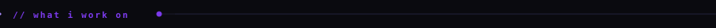
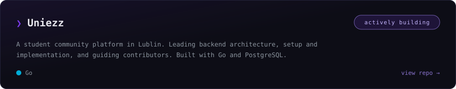
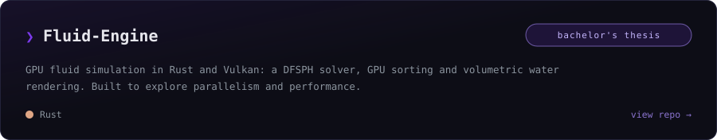
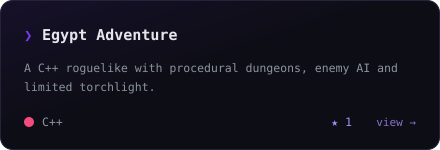
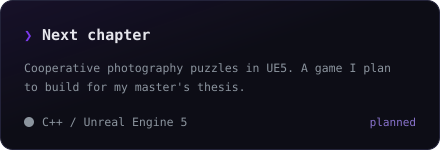
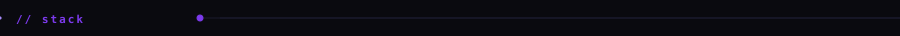

 

&nbsp;
&nbsp;

 

 

 

 

<table width="100%">
<tr>
<td width="50%">

</td>
<td width="50%">

</td>
</tr>
</table>

Fluid Engine — simulation preview

 

Offline-rendered showcase with approximately 155,000 particles. Runtime benchmarks and technical details are in the repository.

 

 

 

