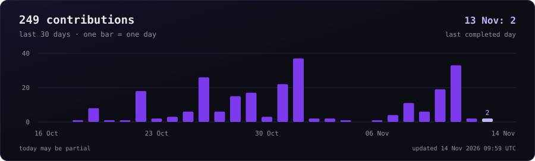

I'm a full-stack developer building products and AI systems end to end.

Beyond my commercial work, I'm deepening my understanding of software architecture, concurrency, and distributed systems — learning how to design software that stays understandable as it grows.

I lead backend development for **[Uniezz](https://github.com/Uniezz/uniezz-backend)**, explored GPU simulation for my bachelor's thesis, and am working toward a cooperative puzzle game for my master's.

[LinkedIn](https://linkedin.com/in/nikita-lysiuk-7682b42ab/) · [X](https://x.com/Nikita_lysiuk06) · [Stack Overflow](https://stackoverflow.com/users/23113955/nikita)

## Selected work

### [Uniezz Backend](https://github.com/Uniezz/uniezz-backend)

**A student community platform in Lublin · active development**

I lead the backend: architecture, project setup, and most of the implementation. I also break down work and guide student contributors through it.

Built in **Go and PostgreSQL**, with university authentication, profiles, a community feed, and media handling. The code reflects what I'm focusing on now: clear module boundaries, consistent transactions, and predictable behaviour under concurrent requests.

[Repository](https://github.com/Uniezz/uniezz-backend) · [Architecture conventions](https://github.com/Uniezz/uniezz-backend/blob/main/docs/CONVENTIONS.md)

### [Fluid Engine](https://github.com/Nikita-Lysiuk/Fluid-Engine)

**GPU fluid simulation · bachelor's thesis**

A **Rust and Vulkan** project exploring particle simulation, GPU parallelism, and rendering. Includes a DFSPH solver, spatial hashing, GPU sorting, volumetric water rendering, and performance measurements.

Offline-rendered showcase with approximately 155,000 particles. See the repository for runtime benchmarks and technical details.

### [Egypt Adventure](https://github.com/Nikita-Lysiuk/egypt_adventure)

A **C++** console roguelike with procedural dungeons, enemy AI, combat, and limited torchlight. An exploration of game systems and procedural generation.

## Exploring next

A cooperative puzzle game in **Unreal Engine 5**, where players use a camera and photography to solve puzzles together. My goal is to develop it over the next two years and make it the basis of my master's thesis.

## Tools I work with

| Area | Tools |
| --- | --- |
| Commercial product work | JavaScript, TypeScript, React, React Native, Node.js, PostgreSQL |
| Backend & architecture | Go, SQL, API design, transactions, background jobs |
| Simulation & games | Rust, C++, Vulkan, GLSL · exploring Unreal Engine 5 |
| AI systems | LLM agents, tool calling, application integrations |
| Delivery & observability | Docker, CI/CD, Sentry, OpenTelemetry |

## Activity

